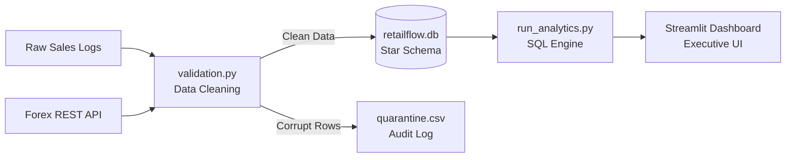

# RetailFlow

An automated data platform and dimensional warehouse that processes 540,000+ transaction records, normalizes international sales to INR via live Forex REST API, and delivers net revenue and customer retention analytics on an executive dashboard.

[Live Dashboard](https://retail-flow.streamlit.app)

---

## Dashboard Preview

<!-- Replace with your dashboard screenshot path, e.g. docs/dashboard_preview.png -->


---

## 1. Business Problem & Impact (Product Context)

Retail platforms face significant profit leakage and reporting inaccuracy due to three factors:

* **Return Revenue Blindness:** Reporting gross sales without separating cancellations overstates realized revenue. In this dataset, returns account for Rs. 11.53 Crores (8.40% of gross sales).
* **Defective Product Categories:** Specific merchandise categories such as Kitchen & Dining (2.33%) and Lighting & Decor (2.25%) exhibit elevated return rates, indicating supplier or packaging defects requiring operational intervention.
* **Customer Retention Gap:** 34% of registered customer accounts make only a single purchase, representing lost lifetime value without targeted re-engagement campaigns.

---

## 2. System Architecture & Data Flow



### Workflow Stages
1. **Ingestion & Normalization (`download_data.py`):** Downloads raw transaction data and queries the `open.er-api.com` REST API for current exchange rates.
2. **Validation & Quarantine (`validation.py`):** Deduplicates records and routes 2,512 non-compliant rows (zero or negative prices) with explicit quarantine reasons into an auditable quarantine file. Missing customer identifiers are preserved as guest checkouts (`GUEST`) to prevent revenue loss.
3. **Star Schema Modeling (`db_pipeline.py`):** Normalizes 534,129 clean line-items into indexed Fact and Dimension tables in SQLite with referential integrity enabled.
4. **Analytics & Presentation (`run_analytics.py` & `app.py`):** Executes relational SQL queries to calculate net financial metrics and serves an interactive dashboard.

---

## 3. Data Warehouse Design (Kimball Star Schema)

The warehouse structures transactional facts and dimensional context for analytical queries:

* **`fact_sales` (Fact Table):**
  * Primary Key: `sales_id`
  * Foreign Keys: `customer_id`, `product_code`, `date_key`
  * Metrics: `quantity`, `unit_price`, `amount_gbp`, `amount_inr`, `is_returned`
* **`dim_customers`:** `customer_id` (PK), `country`
* **`dim_products`:** `product_code` (PK), `description`, `category`
* **`dim_dates`:** `date_key` (PK, YYYYMMDD), `full_date`, `year`, `month`, `quarter`, `day_of_week`

B-Tree indexes are created on `fact_sales(customer_id)`, `fact_sales(product_code)`, and `fact_sales(date_key)` to accelerate join performance.

---

## 4. Key Metrics Summary

| Metric | Measured Value | Description |
| :--- | :--- | :--- |
| **Total Ingested Records** | 541,909 rows | Raw transaction extract |
| **Duplicate Deductions** | 5,268 rows | Exact duplicate rows removed |
| **Quarantined Records** | 2,512 rows (0.5%) | Invalid rows with unit price <= 0, logged with quarantine reason |
| **Clean Warehouse Line-Items** | 534,129 rows | Verified records stored in `fact_sales` (534,129 + 2,512 + 5,268 = 541,909) |
| **Completed Orders** | 23,796 orders | Distinct invoices processed |
| **Gross Sales Volume** | Rs. 137.31 Cr | Total sales before return deductions |
| **Return Deductions** | -Rs. 11.53 Cr (8.40%) | Refunds resulting from customer cancellations |
| **Net Realized Revenue** | Rs. 125.78 Cr | Actual cash revenue generated |

---

## 5. Key Findings & Actions

* **Revenue Seasonality:** Sales increase steadily throughout the year and peak in November (Q4 accounts for over 35% of annual revenue). Inventory staging should occur 60 days prior to Q4.
* **Return Concentration:** Kitchen & Dining (2.33%) and Lighting & Decor (2.25%) exhibit the highest return rates. Operations should prioritize supplier quality audits on fragile SKUs in these categories.
* **Customer Retention:** High-frequency buyers (5+ orders) represent 25.5% of registered customer accounts but drive substantial lifetime value. Marketing should deploy 30-day post-purchase offers to convert single-order buyers into repeat customers.

---

## 6. Assumptions & Limitations

* **Illustrative Currency Conversion:** The pipeline fetches current exchange rates via REST API (`open.er-api.com`) to demonstrate real-time external data integration. Because the dataset spans 2010–2011, converted INR figures serve as an illustrative standardization rather than historical spot rates.
* **Guest Checkout Preservation:** Unregistered transactions (~132k rows with missing `CustomerID`) are retained under a synthetic `GUEST` account in `dim_customers` to maintain accurate revenue and order totals, while customer-level frequency and LTV metrics explicitly evaluate registered users.
* **Product Categorization:** Because the source dataset lacks product taxonomy, categories are derived using deterministic keyword matching across SKU descriptions (e.g., bags, lighting, kitchenware) with unmatched items routed to "Gifts & Novelties".
* **Storage & Concurrency:** Designed as a single-node SQLite dimensional warehouse, optimal for analytical reporting and dashboard exploration under moderate data volumes without distributed infrastructure overhead.

---

## 7. How to Run

### Local Setup
```bash
# 1. Clone repository and install dependencies
git clone https://github.com/AditiAhuja01/retail-flow.git
cd retail-flow
pip install -r requirements.txt

# 2. Run data workflow
python src/download_data.py
python src/validation.py
python src/db_pipeline.py
python src/run_analytics.py

# 3. Launch dashboard
streamlit run app.py
```

### Docker Execution
```bash
docker compose up
```
Open `http://localhost:8501` in your browser.
