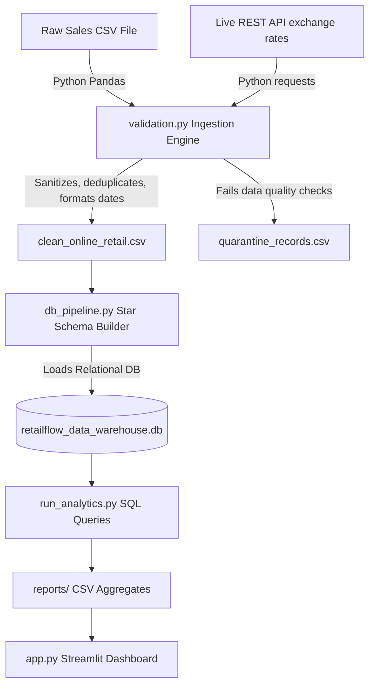

# Multi-Source E-Commerce ETL & Analytics Pipeline (RetailFlow-Pipeline)

## 📌 1. The Problem Statement
Retail platforms suffer significant profit margin losses due to two main challenges:
1. **High Product Return Rates (Reverse Logistics):** Identifying which product categories have defects or sizing issues, and flagging "serial returners" who abuse return policies.
2. **Poor Retention Strategies:** Understanding the customer base to separate high-value repeat buyers (VIPs) from inactive, dormant customers.

Additionally, global retail platforms struggle to evaluate net revenue when transactions span international boundaries with different currencies.

To solve this, we need an automated data engineering pipeline that ingests raw sales logs (~540,000 records) and live currency exchange rates via a REST API, validates and cleans the data, structures it into a dimensional database, and runs business analytics.

---

## 🛠️ 2. The Solution
We built a lightweight, end-to-end **Data Engineering Pipeline** using **Python, Pandas, SQLite, and Streamlit**. It pulls raw CSV transactions and live REST API exchange rates, runs a clean ETL (Extract, Transform, Load) flow, and stores them in a Star Schema Data Warehouse.

### The Pipeline Architecture


### The Data Warehouse Schema (Star Schema)
To optimize analytical query performance, the flat transaction data is normalized into a relational Star Schema:

*   **`fact_sales` (Fact Table):** Contains transactional facts (`quantity`, `unit_price`, converted currency amounts `amount_inr` / `amount_gbp`) and links to dimension tables.
*   **`dim_customers` (Dimension Table):** Stores unique customer IDs and their country of origin.
*   **`dim_products` (Dimension Table):** Stores product codes, cleaned names, and categories (automatically classified using description text).
*   **`dim_dates` (Dimension Table):** Simplifies time-series grouping by storing parsed day, month, year, quarter, and day-of-week attributes.

---

## 3. Key SQL Insights & Business Analytics
We run analytical SQL queries in [`run_analytics.py`](file:///c:/Users/Aditi%20Ahuja/CV-Projects/neoretail_pipeline/src/run_analytics.py) to answer critical retail questions:

1. **Monthly Seasonality:** Joins `fact_sales` with `dim_dates` to evaluate order volumes and month-over-month growth.
2. **Category Performance & Reverse Logistics:** Computes net revenue and return rate percentages (`CAST(SUM(is_returned) AS REAL) / COUNT(*) * 100`) across product categories.
3. **Customer Lifetime Value (LTV):** Identifies top VIP customers while filtering out return credit notes (`WHERE is_returned = 0`).
4. **Customer Frequency Segmentation:** Classifies customers into *VIP Customers (5+ orders)*, *Repeat Customers (2-4 orders)*, and *One-Time Customers (1 order)* using conditional `CASE WHEN` statements.

---

## 4. Quickstart Guide

### 1. Install Dependencies
```bash
pip install -r requirements.txt
```

### 2. Execute Data Pipeline
Run the ETL scripts in order:
```bash
python src/download_data.py
python src/validation.py
python src/db_pipeline.py
python src/run_analytics.py
```

### 3. Launch the Dashboard
```bash
streamlit run app.py
```

### 4. Containerized Execution (Docker)
To spin up the entire pipeline and dashboard without local Python setup:
```bash
docker compose up
```
Open `http://localhost:8501` in your browser.
