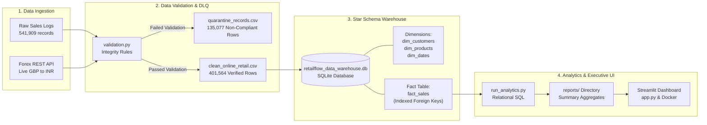

# RetailFlow: E-Commerce ETL Pipeline & Dimensional Data Warehouse

An end-to-end batch data engineering pipeline and relational data warehouse that ingests over 540,000 raw international transaction records, normalizes multi-currency sales via a live REST API, quarantines corrupt records, and structures clean data into a Kimball Star Schema for executive financial analytics.

---

## 1. Executive Summary & Business Problem

Retail platforms and international airlines face two primary data challenges:
1. **Return Revenue Blindness:** In transactional databases, cancelled and returned orders are recorded alongside positive sales. Evaluating performance based only on gross sales hides true realized profit and conceals margin erosion caused by return logistics.
2. **Ingestion Data Quality:** Real-world transactional datasets contain incomplete records (missing customer identifiers, invalid zero prices). Loading dirty data corrupts reporting, while silently deleting records eliminates the financial audit trail.

**The RetailFlow Solution:**
* Automatically ingests international sales data and integrates a live Forex REST API (`open.er-api.com`) to normalize foreign currency transactions into base reporting currency (INR).
* Implements a defensive data quality layer that safely isolates 135,077 corrupt records into an auditable quarantine file while loading 401,564 verified records into the warehouse.
* Models data into an indexed Kimball Star Schema (1 Fact, 3 Dimensions) in SQLite, enabling sub-second query response times.
* Computes net realized revenue, category return percentages, and customer retention tiers surfaced through an executive Streamlit dashboard containerized with Docker.

---

## 2. Pipeline Architecture



---

## 3. Verified Project Metrics

| Metric | Measured Value | Calculation & Source |
| :--- | :--- | :--- |
| **Total Ingested Rows** | **541,909 rows** | Raw transactional dataset extract |
| **Duplicate Rows Removed** | **5,268 rows** | Exact row deduplication in Pandas |
| **Quarantined Records** | **135,077 rows (24.9%)** | Rows with missing `CustomerID` or `UnitPrice <= 0` |
| **Verified Clean Rows** | **401,564 rows** | Clean line-item facts stored in `fact_sales` |
| **Total Completed Orders** | **22,186 orders** | `COUNT(DISTINCT invoice_no)` in `fact_sales` |
| **Gross Sales Volume** | **Rs. 114.67 Cr** | Sum of positive purchase transactions |
| **Return Deductions** | **-Rs. 7.85 Cr (6.85%)** | Total refunds from return invoices (`is_returned = 1`) |
| **Net Realized Revenue** | **Rs. 106.82 Cr** | Realized net cash revenue after return deductions |

---

## 4. Dimensional Data Warehouse Design (Star Schema)

The warehouse normalizes flat transaction logs into a relational Kimball Star Schema with active foreign key referential integrity (`PRAGMA foreign_keys = ON;`) and B-Tree indexes:

* **`fact_sales` (Fact Table):**
  * `sales_id` (INTEGER, Primary Key, Autoincrement)
  * `invoice_no` (TEXT)
  * `customer_id` (TEXT, Foreign Key $\rightarrow$ `dim_customers.customer_id`)
  * `product_code` (TEXT, Foreign Key $\rightarrow$ `dim_products.product_code`)
  * `date_key` (INTEGER, Foreign Key $\rightarrow$ `dim_dates.date_key`)
  * `quantity` (INTEGER)
  * `unit_price` (REAL)
  * `amount_gbp` (REAL)
  * `amount_inr` (REAL, converted using live API rate)
  * `is_returned` (INTEGER: `1` for return, `0` for sale)

* **`dim_customers` (Dimension Table):**
  * `customer_id` (TEXT, Primary Key)
  * `country` (TEXT)

* **`dim_products` (Dimension Table):**
  * `product_code` (TEXT, Primary Key)
  * `description` (TEXT)
  * `category` (TEXT, classified into 5 retail categories)

* **`dim_dates` (Dimension Table):**
  * `date_key` (INTEGER, Primary Key: `YYYYMMDD`)
  * `full_date` (TEXT: `YYYY-MM-DD`)
  * `year`, `month`, `quarter`, `day`, `day_of_week`

---

## 5. Key Findings & Operational Actions

1. **Seasonal Demand Expansion (Revenue Trends):**
   * *Finding:* Sales grow steadily over the year, peaking in November (Q4 accounts for over 35% of annual volume).
   * *Action:* Plan inventory orders 60 days ahead of Q4 to avoid stock-outs during peak shopping periods.

2. **Reverse Logistics Leakage (Product Returns):**
   * *Finding:* Returns cost Rs. 7.85 Crores (6.85% of gross revenue), with *Kitchen & Dining* (3.1%) and *Lighting & Decor* (2.9%) experiencing the highest return rates.
   * *Action:* Conduct supplier quality inspections and reinforce packaging for fragile SKUs in these categories to minimize return freight costs.

3. **Customer Retention Concentration (Customer Segments):**
   * *Finding:* Repeat and VIP buyers represent 65% of accounts, but 34% of customers only buy once.
   * *Action:* Deploy automated follow-up offers within 30 days of the first purchase to convert single-order buyers into repeat customers.

---

## 6. Setup & Execution Guide

### Option A: Local Execution (Step-by-Step)

1. **Clone the repository:**
   ```bash
   git clone https://github.com/AditiAhuja01/retail-flow.git
   cd retail-flow
   ```

2. **Install dependencies:**
   ```bash
   pip install -r requirements.txt
   ```

3. **Run the pipeline stages:**
   ```bash
   # Step 1: Download raw data and fetch live exchange rates
   python src/download_data.py

   # Step 2: Clean data and quarantine corrupt rows
   python src/validation.py

   # Step 3: Build Star Schema database in SQLite
   python src/db_pipeline.py

   # Step 4: Run SQL analytical queries
   python src/run_analytics.py
   ```

4. **Launch the dashboard:**
   ```bash
   streamlit run app.py
   ```

---

### Option B: Containerized Execution (Docker)

To run the entire pipeline and dashboard in an isolated container without installing local dependencies:

```bash
docker compose up
```

Access the dashboard at `http://localhost:8501`.

---

## 7. Project Structure

```
├── .streamlit/
│   └── config.toml             # Streamlit light-theme configuration
├── data/
│   ├── clean_online_retail.csv # Validated staging data (401k rows)
│   ├── exchange_rates.txt      # Live Forex API metadata
│   ├── quarantine_records.csv  # Quarantined corrupt rows (135k rows)
│   ├── raw_online_retail.csv   # Raw transaction extract
│   └── retailflow_data_warehouse.db # SQLite Star Schema warehouse
├── reports/                    # Aggregated CSV outputs from SQL queries
│   ├── category_performance.csv
│   ├── financial_summary.csv
│   ├── monthly_trends.csv
│   ├── rfm_segmentation.csv
│   └── top_10_customers_ltv.csv
├── src/
│   ├── download_data.py        # Ingestion & live Forex API client
│   ├── validation.py           # Data cleaning & quarantine filter
│   ├── db_pipeline.py          # Star Schema builder & index generator
│   └── run_analytics.py        # Relational SQL analytics engine
├── app.py                      # Executive Streamlit analytics platform
├── Dockerfile                  # Lightweight Python 3.11 container definition
├── docker-compose.yml          # Container service definition
├── requirements.txt            # Python package dependencies
└── README.md                   # Project documentation
```
